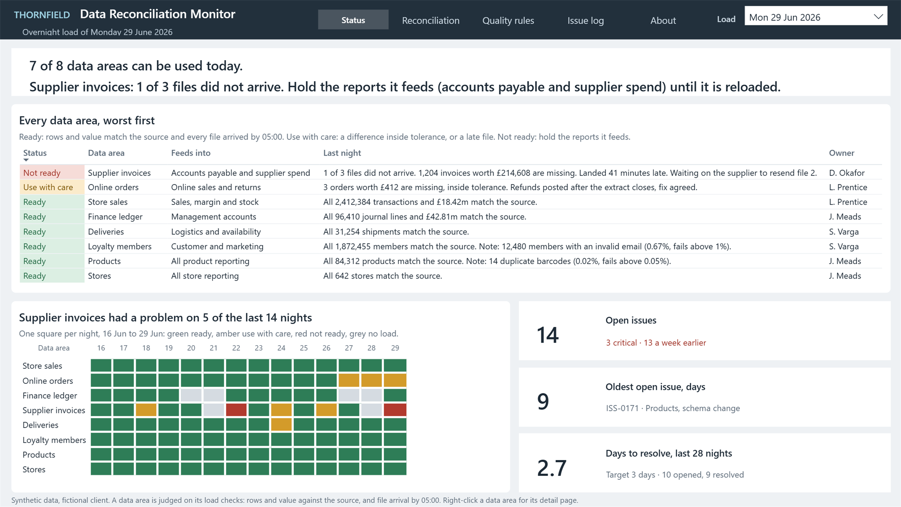
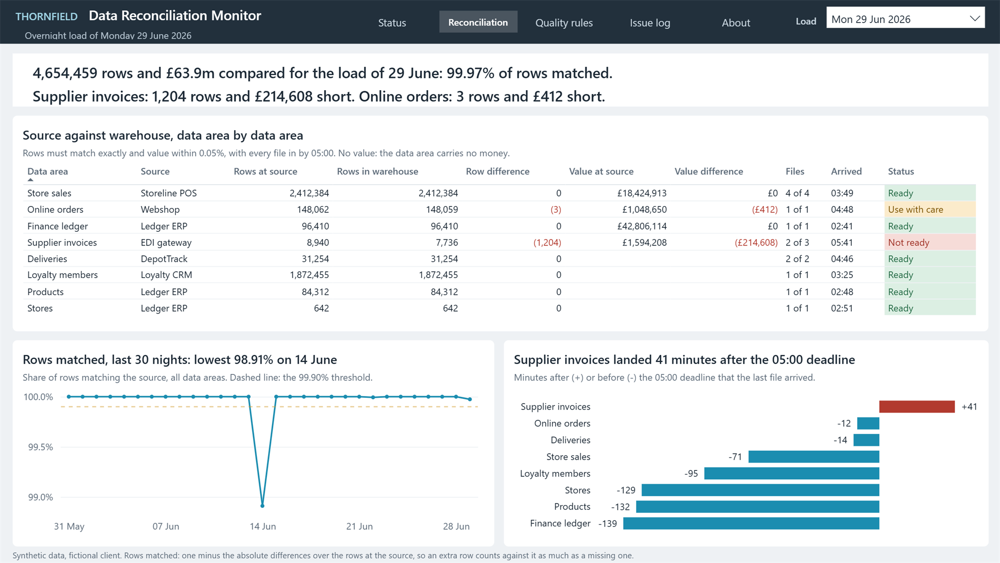

# Data Reconciliation Monitor

A morning check for a retailer whose warehouse is loaded every night from six source systems. Before the business opens its dashboards, the first page says in plain words which data can be used today, which reports to hold back, and why. The pages behind it give the data team the evidence: source against warehouse, the quality rules, and the issue log.

Synthetic data, fictional client (Thornfield Retail Group).

## What it shows (load of 29 June 2026)

- Seven of eight data areas can be used. Supplier invoices are not ready: one of three files never arrived, so 1,204 invoices worth £214,608 are missing. Accounts payable and supplier spend reporting should wait for the resend.
- Online orders are three orders (£412) short for the third night running, inside tolerance and traced to refunds posted after the extract closes. Fine for trends.
- Supplier invoices are the recurring problem: trouble on 5 of the last 14 nights and 5 of the 14 open issues, mostly late or incomplete files from the supplier.
- Issues are resolved in 2.7 days on average, inside the 3-day target, but 14 are open against 2 a month earlier.

## Pages

Status, Reconciliation, Quality rules, Issue log and About, plus a Data area page reached by right-clicking any data area. The Load dropdown picks any of the 90 nights, and the report shows how things stood that morning.

## How it is built

- The facts are measurements about the data: rows and value at the source and in the warehouse, files received and when, and records failing each of 48 quality rules.
- No status is stored. One measure compares every check with the thresholds in the `Rule` table, so changing a tolerance changes every status in the report.
- Only the load checks (rows, value, file arrival) decide whether a data area can be used. Quality-rule warnings show as notes.
- The Load dropdown filters `Date`. Trend charts use a separate `Night` axis and `TREATAS`, so they show the nights leading up to the load selected.
- `Issue` is not related to `Date`. Its measures compare the dates opened and resolved with the night selected, so the log reads as it stood that morning.
- Power Query keeps the latest of two result sets written for 14 June and cleans arrival times recorded three ways. One issue closed before it was opened is counted and left out of the averages.

The figures above were recalculated from the CSVs outside Power BI and match the report.

## Opening it

1. Open `Data Reconciliation Monitor.pbip` in Power BI Desktop.
2. In Transform data, set `Data Folder` to this project's [`data`](data/) folder and refresh.

`node generator/generate-data.js` rebuilds the CSVs. See [`generator/`](generator/).
