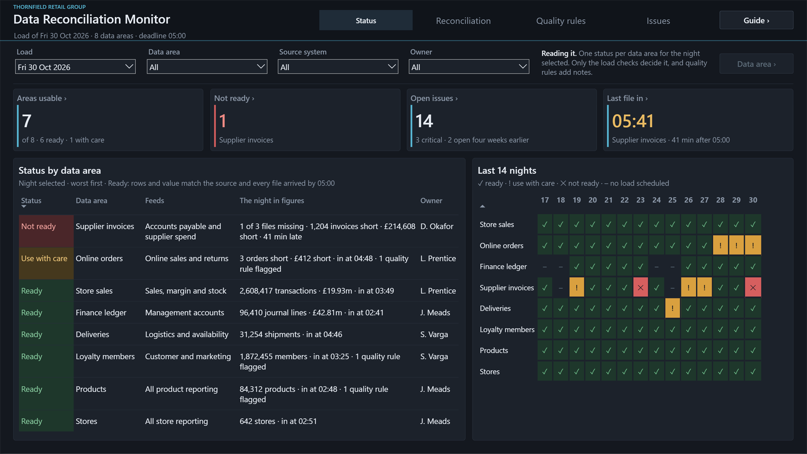
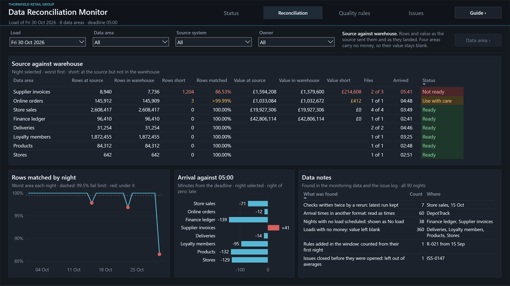
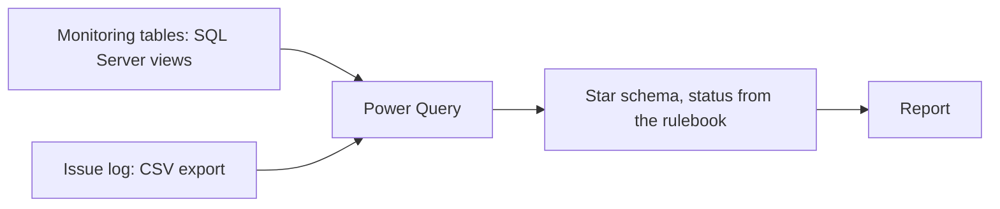

# Data Reconciliation Monitor

A morning check that tells the business which data it can use today, and gives the data team the evidence behind every answer.

Synthetic data, fictional client (Thornfield Retail Group).

## The problem

Thornfield's warehouse is loaded every night from six source systems into eight data areas that finance, trading and supply chain report from. When a load failed, the business found out from a wrong figure in a meeting. The data team needed one page to say, before the reports were opened, which areas could be used and which reports to hold back.

## What it showed (load of Friday 30 October 2026)

- **Seven of eight areas can be used.** Supplier invoices are not ready: one of three files did not arrive, so 1,204 invoices worth £214,608 are missing and the last file landed at 05:41, 41 minutes late. Accounts payable and supplier spend reporting waits for the resend.
- **Supplier invoices are the recurring problem.** They had trouble on 5 of the last 14 nights and hold 5 of the 14 open issues, mostly late or incomplete files from the supplier. Online orders are 3 orders (£412) short for the third night running, inside tolerance and traced to refunds posted after the extract closes, so they are fine for trends.
- **The team resolves issues on time, but the queue is growing.** Issues closed in the last four weeks took 2.8 days on average against a 3-day target, yet 14 are open against 2 four weeks earlier. The backlog, not the speed, is the conversation for the data team lead.

## Pages

Status, Reconciliation, Quality rules and Issues, with Load, data area, source system and owner filters at the top of every page. Load picks any of the last 90 nights, and every page then shows that morning as it stood, the issue log included. Select an area and press Data area, or right-click it, for everything about that area. The Guide button explains how to read the monitor.

## How it is built

- **No status is stored.** The load records what it moved: rows and value at the source and in the warehouse, files received and when, and records failing each of 48 rules. One measure compares those figures with the limits in the rulebook, so a tolerance changes in one place and every status follows.
- **Only the load checks decide whether an area can be used.** Rows and value against the source and files in by 05:00 set the status; the other quality rules add notes for the data team and never hold a report back.
- **Any past morning reads as it was.** Trend charts use their own night axis, so they always end on the night selected, and the issue measures compare the dates opened and resolved with that night, so the queue shows what was open at the time.

The data carries the problems real monitoring tables do: one night's store sales checks written twice by a rerun, arrival times recorded in three formats, nights with no load scheduled, areas with no money to reconcile, a rule added part-way through the window and an issue closed before it was opened. The views keep the latest run and read every time, and the Reconciliation page counts each problem.

Every figure above was recalculated from the CSV files outside Power BI and matches the report.

## Opening it

1. Build the database: `sql\build.cmd` creates `ThornfieldDW` on SQL Server on localhost. For another server, pass its name, for example `sql\build.cmd (localdb)\MSSQLLocalDB`.
2. Open `Data Reconciliation Monitor.pbip` in Power BI Desktop. In Transform data, set `Server` and `Database` to match, set `Issue Log Folder` to this project's [`data`](data/) folder, and refresh. Use Windows credentials for SQL Server.

`node generator/generate-data.js` rebuilds the data. See [`generator/`](generator/).
