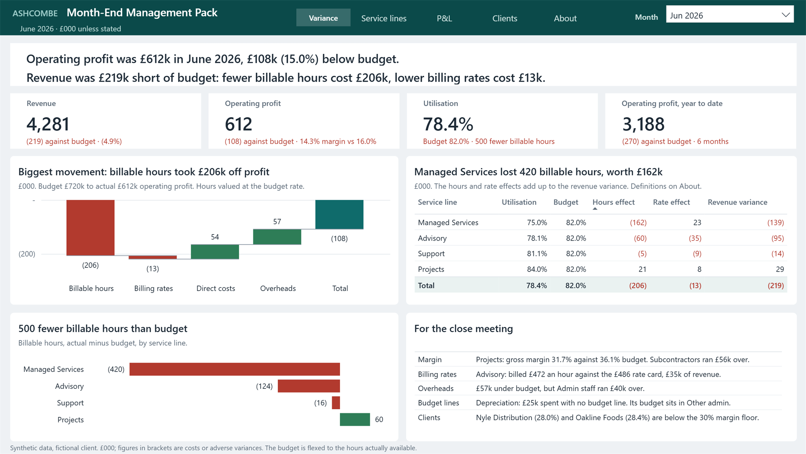
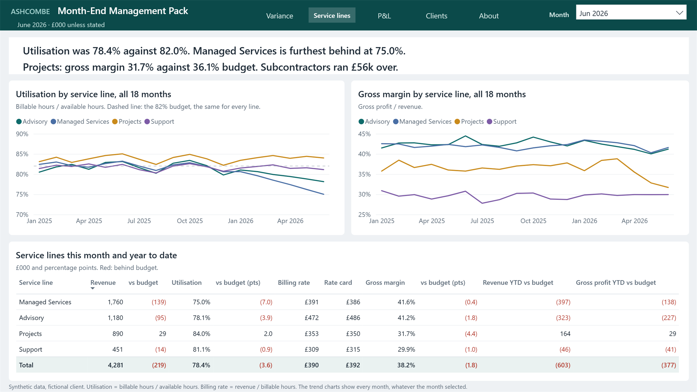

# Month-End Management Pack

A month-end pack for a professional-services firm with three companies, four service lines and 13 clients, built for the close meeting. The meeting starts with one question: why is profit different from budget? The pack answers it on the first page, separates volume from price, and lists the points the meeting should discuss. The other pages hold the trends, the full P&L and the client view.

Synthetic data, fictional client (Ashcombe Partners).

## What it shows (June 2026)

- Operating profit was £612k against a £720k budget. Revenue was £219k short and £206k of that was billable hours.
- Managed Services lost 420 hours. Its utilisation has fallen every month this year, from 80.6% in January to 75.0%, so this is a resourcing question more than a sales one.
- Projects' gross margin was 31.7% against 36.1%, with subcontractors £56k over budget. Advisory billed £472 an hour against a £486 rate card.
- Two clients are below the 30% margin floor, Nyle Distribution and Oakline Foods.
- Overheads were £57k under budget, which softened the month, though admin staff costs have risen every month this year.

Year to date, operating profit is £270k behind budget.

## Pages

Variance, Service lines, P&L, Clients and About. One Month dropdown drives every page. The two trend charts on Service lines always show all 18 months.

## How it is built

- The budget is flexed: 82% utilisation and the rate card applied to the hours each team actually had. What is left of the revenue variance splits into an hours effect and a rate effect, worked out by service line and month so that a shift towards cheaper work does not read as discounting.
- Amounts are stored as profit contributions, revenue positive and costs negative, so a positive variance is favourable on every line.
- The P&L layout comes from a small `P&L Line` table and one measure, so subtotals and margins sit where an accountant expects them.
- The headlines, chart titles and the points for the meeting are measures, with a £5k threshold so the meeting is not given noise.
- Power Query removes a journal batch exported twice, cleans hand-typed client names and makes every cost negative, which fixes one posted with the wrong sign. Depreciation has no budget line, and the P&L shows that instead of a variance percentage.

The figures above were recalculated from the CSVs outside Power BI and match the report.

## Opening it

1. Open `Month-End Management Pack.pbip` in Power BI Desktop.
2. In Transform data, set `Data Folder` to this project's [`data`](data/) folder and refresh.

`node generator/generate-data.js` rebuilds the CSVs. See [`generator/`](generator/).
