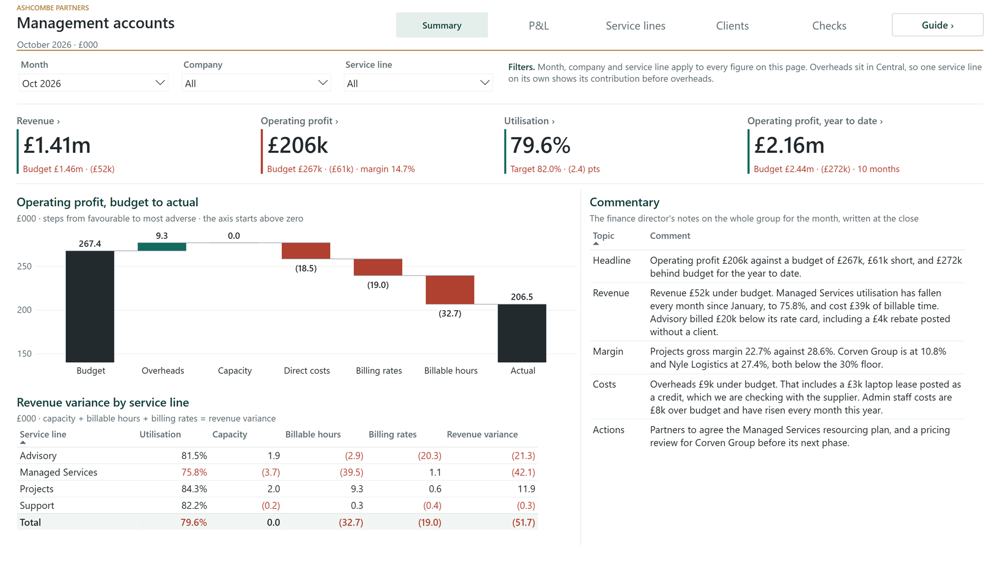
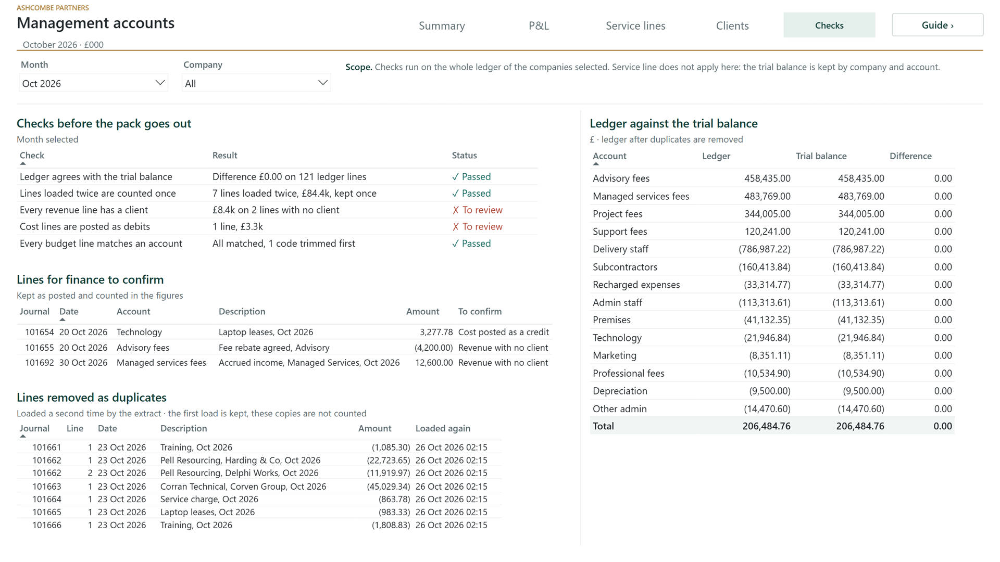
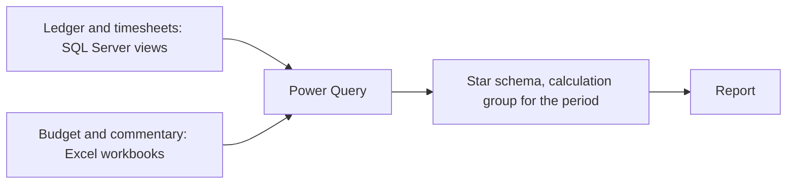

# Month-End Management Pack

A monthly management pack that tells the partners why profit differs from budget, and checks itself against the ledger before it goes out.

Synthetic data, fictional client (Ashcombe Partners).

## The problem

Ashcombe Partners runs four service lines across three companies. The monthly pack was assembled in Excel from ledger exports, so the close meeting spent its time agreeing the numbers rather than explaining them. The partners wanted one answer at the start of every close: why is profit different from budget, and what do we do about it?

## What it showed (October 2026)

- **The shortfall is billable time, not capacity.** Operating profit was £206k against a budget of £267k. Available hours were on plan, but Managed Services lost £39k of billable time: its utilisation has fallen every month since January, to 75.8% against an 82% target. The answer is resourcing in that line, not hiring.
- **Price and subcontractors take the rest.** Advisory is still billing at 2025 rates, £20k below its rate card this month and £158k over the year. Projects lost gross margin to subcontractors, 22.7% against 28.6%, and Corven Group, at 10.8%, sits with Nyle Logistics below the 30% margin floor. Both clients need a pricing review.
- **The pack proves itself before it goes out.** The ledger agrees with the trial balance to the penny once seven lines loaded twice by the extract are removed. Two items are left for finance to confirm: £8.4k of revenue posted with no client, and a laptop lease posted as a credit that flatters overheads.

## Pages

Summary, P&L, Service lines, Clients and Checks, with Month, Company and Service line filters at the top of every page. Right-click any line of the P&L for the journal lines behind it. The Guide button explains how to read the pack.

## How it is built

- **The views do the cleaning.** SQL views hand the model one row per journal line, amounts with their effect on profit and a client for every line. Power Query stays thin and folds back to the server; only the finance workbooks are shaped in Power Query.
- **The revenue variance splits three ways, exactly.** Capacity, billable hours and billing rates are valued so that they add up to the revenue variance to the pound, so leave and vacancies never show as lost sales.
- **The period is set in one place.** A calculation group gives every measure its month, year to date and last-year versions, and the statement is read from a layout table, so its logic is written once.

The files carry the problems real extracts do: a batch of purchase invoices loaded twice, manual journals with no client, a cost posted as a credit, depreciation with no budget line, and an account code typed with a trailing space. The Checks page counts each one.

Every figure above was recalculated from the CSV files outside Power BI and matches the report.

## Opening it

1. Build the database: `sql\build.cmd` creates `AshcombeFinance` on SQL Server on localhost. For another server, pass its name, for example `sql\build.cmd (localdb)\MSSQLLocalDB`.
2. Open `Month-End Management Pack.pbip` in Power BI Desktop. In Transform data, set `Server` and `Database` to match, set `Finance Folder` to this project's [`finance`](finance/) folder, and refresh. Use Windows credentials for SQL Server.

`node generator/generate-data.js` rebuilds the data, and `generator/build-workbooks.ps1` the workbooks. See [`generator/`](generator/).
