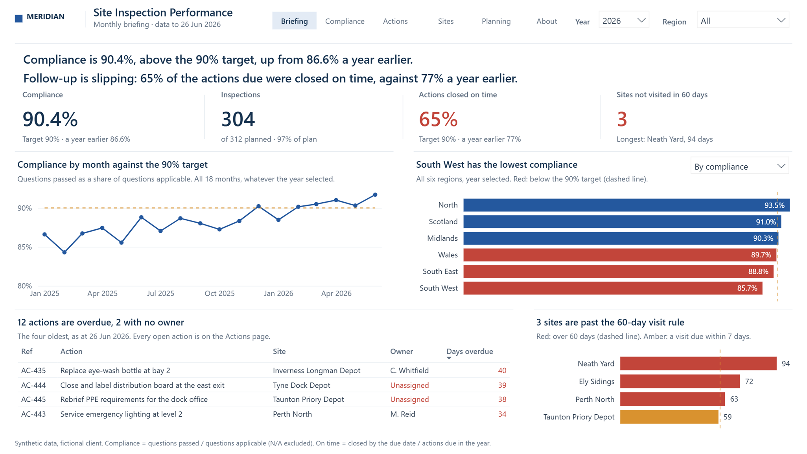
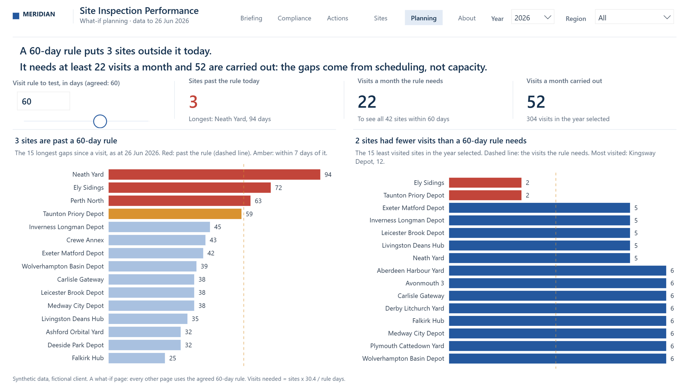

# Site Inspection Performance

A monthly briefing for the operations review of a facilities operator: 42 sites in six UK regions, 18 months of health, safety and compliance inspections. The review asks four questions. Is compliance on target, are we inspecting as planned, are corrective actions closed on time, and which sites need a visit? The first page answers them and the other pages hold the evidence.

Synthetic data, fictional client (Meridian Facilities Group).

## What it shows (data to 26 June 2026)

- Compliance is 90.4% this year, above the 90% target and up from 86.6%. South West is the weakest region at 85.7%.
- Follow-up is slipping. 65% of corrective actions were closed by their due date, against 77% a year earlier. Twelve are overdue and two of them have no owner.
- Three sites are past the 60-day visit rule, Neath Yard by the widest margin at 94 days.
- The visit gaps come from scheduling. The rule needs 22 visits a month and 52 are made, but Kingsway Depot had 12 visits this year while Ely Sidings and Taunton Priory Depot had two each.

## Pages

Briefing, Compliance, Actions, Sites, Planning and About, plus a Site detail page reached by drillthrough. Year and Region filter every page. The Planning page tests the visit rule from 15 to 90 days, and a dropdown on the Briefing switches the region chart between four measures.

## How it is built

- Star schema: Inspection, Response and Action as facts, with Site, Person, Question and Date, the monthly inspection plan, and two parameter tables.
- `Compliance %` (questions passed over questions applicable) is the one measure behind every compliance figure, so the pages always agree.
- Every "as at" figure uses the `As-at Date` measure, the latest inspection, so the report shows the same numbers whenever it is opened.
- On-time closure is judged against the month an action fell due, through an inactive relationship on the due date.
- The export has five inspections exported twice, site names typed differently, two actions with no owner and one pointing at an inspection that does not exist. Power Query and the measures handle each one, and the report shows them where they matter.

The figures above were recalculated from the CSVs outside Power BI and match the report.

## Opening it

1. Open `Site Inspection Performance.pbip` in Power BI Desktop.
2. In Transform data, set `Data Folder` to this project's [`data`](data/) folder and refresh.

`node generator/generate-data.js` rebuilds the CSVs. See [`generator/`](generator/).
