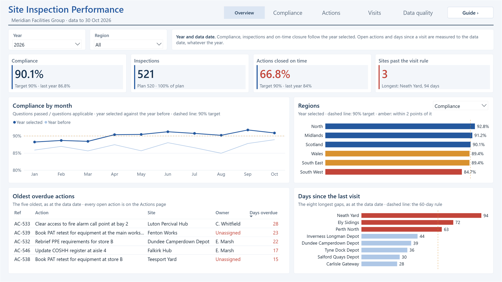
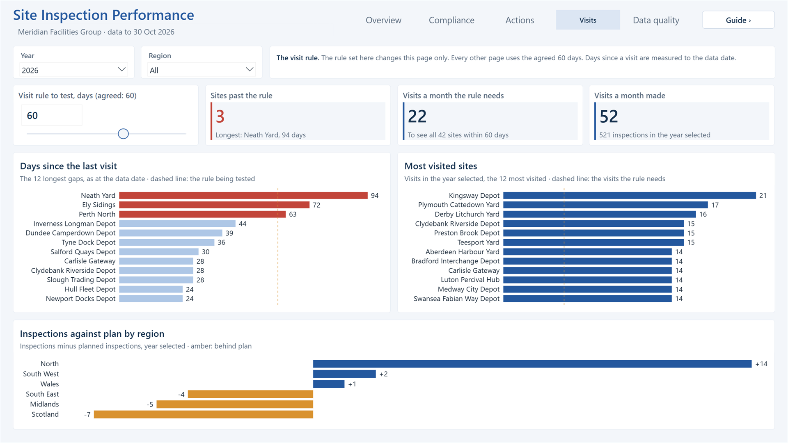
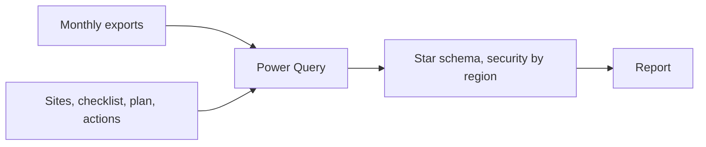

# Site Inspection Performance

A monthly briefing that tells an operations team whether its inspection programme is on track, and where to act next.

Synthetic data, fictional client (Meridian Facilities Group).

## The problem

Meridian inspects 42 sites in six UK regions against a 24-question safety checklist. Every month the inspection app produced a new export, and the operations review spent its first hour putting the figures together instead of deciding what to do about them. Each regional manager also needed to see their own region, and only their own.

## What it showed (data to 30 October 2026)

- **Compliance is above target, but not everywhere.** 90.1% so far this year against 86.8% over the same months of 2025. Still, 18 of the 42 sites are below the 90% target, South West is the weakest region at 84.7% and Signage the weakest section at 85.9%, so that is where next quarter's visits and briefings go.
- **Follow-up is slipping.** 66.8% of corrective actions were closed by their due date, against 84% a year earlier. Eleven are overdue and two of them have no owner, which the review can fix on the day.
- **The visit gaps come from scheduling.** Inspectors make 52 visits a month where the 60-day rule needs 22, yet three sites are past the rule, Neath Yard at 94 days. Kingsway Depot has had 21 visits this year, four times what the rule needs. A fairer schedule closes the gaps without adding inspectors.

## Pages

Overview answers the review's four questions. Compliance, Actions and Visits hold the evidence behind each answer, and Data quality shows what was found and corrected in the files. Right-click a site for its detail page. The Guide button opens a page on how to read the report.

## How it is built

- **The exports are read as the app writes them.** One file a month, one column per question. Power Query combines the folder, turns the checklist into rows and keeps the latest version of any inspection edited after it was submitted, so a new month needs no change.
- **One compliance measure everywhere.** Questions passed over questions applicable, the same from the whole estate down to a single inspection, so the pages always agree.
- **Security by region, with the plan to match.** Regional managers see only their region, and their inspections are measured against their region's plan.
- **One data date.** Every "as at" figure is measured to the last inspection in the exports, so the report gives the same answers whenever it is opened.

The files carry the problems real exports do: inspections exported twice after an edit, a change of date format in August 2026, site names typed differently in the actions list, actions with no owner and one pointing at an inspection that does not exist. The Data quality page counts each one.

Every figure above was recalculated from the CSV files outside Power BI and matches the report.

## Opening it

1. Open `Site Inspection Performance.pbip` in Power BI Desktop.
2. In Transform data, set `Data Folder` to this project's [`data`](data/) folder and refresh.
3. To check the security, use View as with the Regional manager role and another user from [`region_access.csv`](data/region_access.csv), for example `n.carter@meridian.example` for South West.

`node generator/generate-data.js` rebuilds the data. See [`generator/`](generator/).
